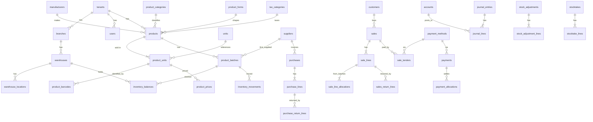

# 04 — Database and Domain Design

MySQL 8.0+, InnoDB, `utf8mb4_0900_ai_ci`. Primary keys are `BIGINT UNSIGNED AUTO_INCREMENT`; every tenant-owned table also carries a `ulid CHAR(26) UNIQUE` used in API URLs so IDs are not guessable across tenants. Conventions below apply unless a table says otherwise:

- `tenant_id BIGINT UNSIGNED NOT NULL` with FK and index on all tenant-owned tables.
- `created_at`, `updated_at`; `created_by`, `updated_by` (FK users) on documents and master data.
- `deleted_at` only where `03-domain-rules.md §18` allows soft deletes.
- Money `DECIMAL(19,4)`; per-base-unit rates `DECIMAL(19,6)`; quantities `DECIMAL(18,3)`.
- Statuses are `VARCHAR(32)` with a CHECK-like validation in code (MySQL ENUM is avoided so adding states is a code change, not a migration).

## 1. ERD (MVP core)

## 2. Table groups

| Group | Tables |
| --- | --- |
| Tenancy | `tenants`, `tenant_settings`, `branches`, `warehouses`, `warehouse_locations`, `document_sequences`, `fiscal_years`, `fiscal_periods` |
| Identity | `users`, `user_branches`, `user_invitations`, `personal_access_tokens`, `roles`, `permissions`, `model_has_roles`, `model_has_permissions`, `role_has_permissions` (spatie), `platform_admins` |
| Catalog | `manufacturers`, `product_categories`, `product_forms`, `units`, `tax_categories`, `taxes`, `tax_category_tax`, `products`, `product_units`, `product_barcodes`, `product_prices` |
| Partners | `suppliers`, `customers`, `price_lists` [P2], `price_list_items` [P2], `customer_prices` [P2] |
| Inventory | `product_batches`, `inventory_balances`, `inventory_movements`, `stock_adjustments`, `stock_adjustment_lines`, `stocktakes`, `stocktake_lines`, `stock_transfers` [P3], `stock_transfer_lines` [P3] |
| Procurement | `purchases`, `purchase_lines`, `purchase_returns`, `purchase_return_lines`, `purchase_requests` [P2], `purchase_orders` [P2], `goods_receipts` [P2] (+ lines) |
| Sales | `sales`, `sale_lines`, `sale_line_allocations`, `sale_tenders`, `sales_returns`, `sales_return_lines` |
| Accounting | `account_groups`, `accounts`, `journal_entries`, `journal_lines`, `payment_methods`, `payments`, `payment_allocations` |
| Communication | `notifications` (Laravel), `notification_rules`, `notification_templates` [P2], `notification_logs` [P2] |
| System | `activity_log` (spatie), `imports`, `import_rows`, `idempotency_keys`, `attachments`, `jobs`, `failed_jobs` |

## 3. Tenancy

**tenants**: `id, ulid, name, legal_name, registration_number, tax_registration_number, logo_path, address, phone, email, timezone, currency_code CHAR(3), fiscal_year_start_month TINYINT, mode, status, opening_balance_date DATE NULL, lock_date DATE NULL, timestamps`.

**tenant_settings**: `id, tenant_id, key VARCHAR(100), value JSON, UNIQUE(tenant_id, key)`. Keys are defined in a PHP enum with type and default; JSON here is acceptable because settings are never queried relationally.

**branches**: `id, ulid, tenant_id, code, name, address, phone, email, is_default, is_active, timestamps, UNIQUE(tenant_id, code)`.

**warehouses**: `id, ulid, tenant_id, branch_id, code, name, is_default, is_active, timestamps, UNIQUE(tenant_id, code)`.

**warehouse_locations**: `id, ulid, tenant_id, warehouse_id, parent_id NULL, type (zone|rack|shelf|bin), code, name, is_active, UNIQUE(tenant_id, warehouse_id, code)`.

**document_sequences**: `id, tenant_id, branch_id NULL, document_type, fiscal_year SMALLINT, prefix, next_number BIGINT UNSIGNED, padding TINYINT, UNIQUE(tenant_id, branch_id, document_type, fiscal_year)`.

**fiscal_years**: `id, tenant_id, name, starts_on, ends_on, status (open|closed), UNIQUE(tenant_id, starts_on)`.
**fiscal_periods**: `id, tenant_id, fiscal_year_id, starts_on, ends_on, status (open|closed)`.

## 4. Identity

**users**: `id, ulid, tenant_id NULL (NULL for platform admins), name, email, password, phone, is_active, must_change_password, last_login_at, timestamps, UNIQUE(email)`.
**user_branches**: `user_id, branch_id, PRIMARY KEY(user_id, branch_id)`.
**user_invitations**: `id, tenant_id, email, role_id, token_hash, invited_by, expires_at, accepted_at`.
Spatie permission tables with `team_foreign_key = tenant_id` so roles are per tenant. Permission names are global and seeded from `06-permissions-matrix.md`.

## 5. Catalog

**manufacturers**: `id, ulid, tenant_id, code, name, address, phone, email, website, contact_person, contact_phone, contact_email, notes, is_active, timestamps, deleted_at, UNIQUE(tenant_id, code)`.

**product_categories**: `id, ulid, tenant_id, parent_id NULL, name, code, is_active, UNIQUE(tenant_id, code)`. Two levels enforced in code.

**product_forms**: `id, tenant_id, name, code, is_active, UNIQUE(tenant_id, code)`.

**units**: `id, tenant_id, name, code, is_active, UNIQUE(tenant_id, code)`. Seeded per tenant from a global list.

**tax_categories**: `id, tenant_id, name, code, is_active`.
**taxes**: `id, tenant_id, name, code, rate DECIMAL(8,4), is_inclusive, is_recoverable_on_purchase, jurisdiction, effective_from DATE, effective_to DATE NULL, is_active`.
**tax_category_tax**: `tax_category_id, tax_id` (a category may stack taxes; MVP UI exposes one).

**products**: `id, ulid, tenant_id, sku, name, generic_name, brand, manufacturer_id NULL, category_id NULL, form_id NULL, strength, pack_description, description, is_prescription_required, tax_category_id, base_unit_id (FK product_units, set after units created), default_sale_unit_id, default_purchase_unit_id, reorder_level DECIMAL(18,3), reorder_quantity, max_stock, preferred_supplier_id NULL, allow_fractional_quantity, track_batches, is_active, timestamps, deleted_at, UNIQUE(tenant_id, sku), FULLTEXT(name, generic_name, brand)`.

**product_units**: `id, tenant_id, product_id, unit_id, factor_to_base DECIMAL(18,6), is_base, is_active, UNIQUE(tenant_id, product_id, unit_id)`. Exactly one `is_base` per product (enforced in code + partial check via trigger-free approach: unique index on `(product_id, is_base_marker)` where marker is NULL unless base).

**product_barcodes**: `id, tenant_id, product_id, product_unit_id, barcode VARCHAR(64), type (manufacturer|internal), is_primary, UNIQUE(tenant_id, barcode)`.

**product_prices**: `id, tenant_id, product_id, product_unit_id, price_type (retail|wholesale), price DECIMAL(19,4), effective_from DATE, created_by, created_at, INDEX(tenant_id, product_unit_id, price_type, effective_from)`.

## 6. Partners

**suppliers**: `id, ulid, tenant_id, code, name, contact_person, phone, whatsapp, email, address, tax_registration_number, payment_terms_days SMALLINT, credit_limit DECIMAL(19,4) NULL, opening_balance DECIMAL(19,4), opening_balance_date, notes, is_active, timestamps, deleted_at, UNIQUE(tenant_id, code)`.

**customers**: `id, ulid, tenant_id, code, type (walk_in|retail|wholesale|institutional), name, phone, whatsapp, email, address, tax_registration_number, credit_limit NULL, payment_terms_days, opening_balance, opening_balance_date, default_price_type (retail|wholesale), is_system (walk-in), is_active, timestamps, deleted_at, UNIQUE(tenant_id, code)`.

## 7. Inventory

**product_batches**: `id, ulid, tenant_id, product_id, batch_number VARCHAR(64), manufacturing_date DATE NULL, expiry_date DATE NULL, supplier_id NULL, unit_cost DECIMAL(19,6), mrp DECIMAL(19,6) NULL, status, notes, timestamps, UNIQUE(tenant_id, product_id, batch_number, expiry_date), INDEX(tenant_id, expiry_date), INDEX(tenant_id, product_id, status, expiry_date)`.

**inventory_balances**: `id, tenant_id, warehouse_id, location_id NULL, product_id, batch_id, quantity DECIMAL(18,3), reserved_quantity DECIMAL(18,3) DEFAULT 0, version INT UNSIGNED, updated_at, UNIQUE(tenant_id, warehouse_id, location_id, product_id, batch_id), INDEX(tenant_id, warehouse_id, product_id)`.
Because MySQL treats NULLs as distinct in unique indexes, `location_id` uses `0` as the "no location" sentinel (FK omitted on that column; integrity enforced in code), or a generated column `location_key = COALESCE(location_id, 0)` is included in the unique index instead. Use the generated-column approach.

**inventory_movements**: `id, tenant_id, warehouse_id, location_id NULL, product_id, batch_id, movement_type, quantity DECIMAL(18,3) (signed), unit_cost DECIMAL(19,6), source_type, source_id, source_line_id NULL, business_date DATE, reference VARCHAR(100), notes, created_by, created_at, INDEX(tenant_id, product_id, business_date), INDEX(tenant_id, batch_id), INDEX(tenant_id, warehouse_id, business_date), INDEX(source_type, source_id)`. No `updated_at`; DB user for the app has no UPDATE/DELETE grant on this table in production (D-26).

**stock_adjustments**: `id, ulid, tenant_id, branch_id, warehouse_id, document_number NULL, business_date, reason_code, notes, status, total_value DECIMAL(19,4), requested_by, approved_by NULL, approved_at, posted_by, posted_at, journal_entry_id NULL, timestamps`.
**stock_adjustment_lines**: `id, adjustment_id, product_id, batch_id, product_unit_id, direction (IN|OUT), quantity, base_quantity, unit_cost DECIMAL(19,6), line_value, notes`.

**stocktakes**: `id, ulid, tenant_id, branch_id, warehouse_id, location_id NULL, document_number, business_date, status, scope JSON (filters used), notes, opened_by, approved_by, completed_at, adjustment_id NULL, timestamps`.
**stocktake_lines**: `id, stocktake_id, product_id, batch_id, expected_base_quantity, counted_base_quantity NULL, variance_base_quantity (generated), unit_cost, counted_by, counted_at, notes`.

## 8. Procurement

**purchases**: `id, ulid, tenant_id, branch_id, warehouse_id, supplier_id, document_number NULL, supplier_invoice_number, supplier_invoice_date, business_date, due_date, payment_type (cash|credit), payment_method_id NULL, status, subtotal, discount_amount, tax_amount, rounding_amount, total, paid_amount, notes, journal_entry_id NULL, reversal_of_id NULL, posted_by, posted_at, idempotency_key NULL, created_by, timestamps, UNIQUE(tenant_id, document_number), INDEX(tenant_id, supplier_id, business_date)`.

**purchase_lines**: `id, purchase_id, product_id, batch_id NULL (set at posting), batch_number, manufacturing_date, expiry_date, product_unit_id, quantity, free_quantity, base_quantity, free_base_quantity, unit_price DECIMAL(19,4), discount_type, discount_value, discount_amount, tax_id NULL, tax_rate, tax_inclusive, tax_amount, line_total, effective_unit_cost DECIMAL(19,6) (per base unit incl. free goods), mrp_per_pack DECIMAL(19,4), returned_base_quantity DEFAULT 0, line_no`.

**purchase_returns**: `id, ulid, tenant_id, branch_id, warehouse_id, supplier_id, purchase_id, document_number, business_date, settlement_type (ap_credit|cash_refund), payment_method_id NULL, status, subtotal, tax_amount, total, reason, notes, journal_entry_id, posted_by, posted_at, timestamps`.
**purchase_return_lines**: `id, purchase_return_id, purchase_line_id, product_id, batch_id, product_unit_id, quantity, base_quantity, unit_cost, tax_amount, line_total`.

## 9. Sales

**sales**: `id, ulid, tenant_id, branch_id, warehouse_id, customer_id, document_number NULL, business_date, status, is_held, held_label, cashier_id, subtotal, line_discount_total, invoice_discount_type, invoice_discount_value, invoice_discount_amount, tax_amount, rounding_amount, total, cogs_total, paid_amount, credit_amount, change_amount, notes, journal_entry_id NULL, voided_by NULL, voided_at, void_reason, reversal_of_id NULL, idempotency_key NULL, posted_by, posted_at, created_by, timestamps, UNIQUE(tenant_id, document_number), INDEX(tenant_id, branch_id, business_date), INDEX(tenant_id, customer_id, business_date), INDEX(tenant_id, status, is_held)`.

**sale_lines**: `id, sale_id, product_id, product_unit_id, forced_batch_id NULL, quantity, base_quantity, unit_price, price_source (override|customer|list|retail|wholesale|mrp), discount_type, discount_value, discount_amount, invoice_discount_share, tax_id, tax_rate, tax_inclusive, tax_amount, line_total, cogs_amount, returned_base_quantity DEFAULT 0, line_no`.

**sale_line_allocations**: `id, sale_line_id, batch_id, base_quantity, unit_cost DECIMAL(19,6), INDEX(batch_id)`.

**sale_tenders**: `id, sale_id, payment_method_id, amount, reference, is_change (bool), payment_id NULL`.

**sales_returns**: `id, ulid, tenant_id, branch_id, warehouse_id, customer_id, sale_id NULL, document_number, business_date, status, subtotal, tax_amount, total, refund_method_id NULL (NULL = AR credit), reason, notes, journal_entry_id, posted_by, posted_at, created_by, timestamps`.
**sales_return_lines**: `id, sales_return_id, sale_line_id NULL, sale_line_allocation_id NULL, product_id, batch_id, product_unit_id, quantity, base_quantity, unit_price, tax_rate, tax_amount, line_total, unit_cost (from the matched allocation), disposition (RESTOCK|WRITE_OFF)`. `sale_line_allocations.returned_base_quantity DEFAULT 0` tracks per-allocation returns.

## 10. Accounting

**account_groups**: `id, tenant_id, parent_id NULL, code, name, type (asset|liability|equity|revenue|cogs|expense), sort_order`.
**accounts**: `id, ulid, tenant_id, group_id, code VARCHAR(20), name, type, normal_balance (debit|credit), system_key VARCHAR(50) NULL (e.g. `inventory`, `ar`, `ap`, `sales_revenue`, `cogs`, `rounding`, `obe`), is_system, is_active, UNIQUE(tenant_id, code), UNIQUE(tenant_id, system_key)`.

**journal_entries**: `id, ulid, tenant_id, document_number, business_date, fiscal_period_id, source_type, source_id, description, status (draft|posted|reversed), total_debit, total_credit, reversal_of_id NULL, posted_by, posted_at, created_by, timestamps, INDEX(tenant_id, business_date), INDEX(source_type, source_id)`.
**journal_lines**: `id, journal_entry_id, tenant_id, account_id, debit DECIMAL(19,4) DEFAULT 0, credit DECIMAL(19,4) DEFAULT 0, description, counterparty_type NULL, counterparty_id NULL (supplier/customer for sub-ledgers), line_no, INDEX(tenant_id, account_id, journal_entry_id)`. Exactly one of debit/credit is non-zero per line.

**payment_methods**: `id, tenant_id, code, name, kind (cash|bank|card|wallet|credit|other), account_id NULL (NULL for credit), is_active, sort_order, UNIQUE(tenant_id, code)`.

**payments**: `id, ulid, tenant_id, branch_id, document_number, direction (in|out), counterparty_type (customer|supplier), counterparty_id, payment_method_id, amount, unallocated_amount, business_date, reference, notes, status (posted|reversed), source_type NULL, source_id NULL (e.g. sale tender), journal_entry_id, reversal_of_id, posted_by, timestamps, INDEX(tenant_id, counterparty_type, counterparty_id)`.
**payment_allocations**: `id, payment_id, document_type (purchase|sale|purchase_return|sales_return|opening), document_id, amount, created_at, UNIQUE(payment_id, document_type, document_id)`.

## 11. System

**imports**: `id, ulid, tenant_id, type, file_path, status (uploaded|validating|validated|failed|processing|completed), total_rows, valid_rows, error_rows, error_file_path, options JSON, created_by, started_at, finished_at`.
**import_rows**: `id, import_id, row_no, payload JSON, status, errors JSON, created_entity_type, created_entity_id`.
**idempotency_keys**: `id, tenant_id, user_id, key VARCHAR(64), request_hash CHAR(64), response_status, response_body JSON, created_at, UNIQUE(tenant_id, user_id, key)`. Rows expire after 24 h.
**attachments**: `id, tenant_id, attachable_type, attachable_id, disk, path, original_name, mime, size, uploaded_by`.
**activity_log** (spatie) with added `tenant_id` and `reason` columns and `INDEX(tenant_id, subject_type, subject_id)`.

## 12. Concurrency

Stock allocation (`03-domain-rules.md §4`) uses `SELECT ... FOR UPDATE` on `inventory_balances` ordered by id. Additional rules:

- `inventory_balances.version` is incremented on every update; the application asserts `affected_rows = 1` on `UPDATE ... WHERE id = ? AND version = ?` as a second guard.
- Document sequences, customer AR limit checks and batch cost updates lock their rows (`FOR UPDATE`) in the posting transaction.
- Transaction isolation: `REPEATABLE READ` (MySQL default) is acceptable because all critical reads are locking reads.
- Deadlock (`1213`) and lock wait timeout (`1205`) are retried up to 3 times by `PostingAction::withRetry()`.

## 13. Indexing strategy

Start with the indexes listed per table. Add composite indexes only from observed `EXPLAIN` plans on representative data (seed 50k products, 200k batches, 1M movements in staging). Reporting queries that cannot be made fast with indexes get read models (summary tables refreshed by events or nightly), not caching of inconsistent results.

## 14. Data integrity rules

1. Foreign keys everywhere, `ON DELETE RESTRICT` by default.
2. Tenant-owned unique keys include `tenant_id`.
3. CHECK constraints (MySQL 8.0.16+): `quantity >= 0` on `inventory_balances`; `debit >= 0 AND credit >= 0 AND NOT (debit > 0 AND credit > 0)` on `journal_lines`; `factor_to_base > 0`.
4. Production DB user lacks `UPDATE`/`DELETE` on `inventory_movements` and `DELETE` on `journal_entries`, `journal_lines`, `payments` (D-26). Migrations run under a separate privileged user.
5. Cross-tenant FK references (e.g. `sale.customer_id` pointing at another tenant's customer) are prevented in Form Requests with `Rule::exists()->where('tenant_id', ...)` and covered by tests.
